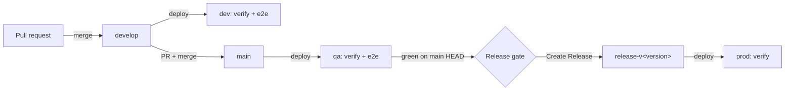

# CI/CD branching strategy and end-to-end tests

Applies to **hello-world-service** (backend) and **helloworld-mcp** (MCP server).
The same document is kept in both repositories.

## 1. Branching model

| Branch / event | Environment | Trigger | Pipeline |
|---|---|---|---|
| Pull request → `develop` or `main` | none (runner) | automatic | Build + unit tests. **MCP only:** PR e2e against the real backend |
| `develop` | dev | push (path-filtered) or manual | deploy → verify → **e2e** → rollback placeholder on failure |
| `main` | qa | push (path-filtered) or manual | deploy → verify → **e2e** → rollback placeholder on failure |
| `release-v<version>` + tag `v<version>` | prod | manual `Create Release` | **QA e2e gate** → create branch, tag and GitHub release → deploy → verify (no e2e) |

`Create Release` always releases the current HEAD of `main`. It is the only path to production.

### Compared with FIPC (Jenkins)

| | FIPC | hello-world |
|---|---|---|
| dev / qa branch | `develop` / `master`, `rel.YYYY.MM.DD` | `develop` / `main` |
| prod | tag `vYYYY.MM.DD` | `release-v<version>` via `Create Release` |
| e2e | dev + qa, separate e2e repo | dev + qa, plus MCP PRs; tests live in each repo |
| release gate | none | QA pipeline for `main` HEAD must be green |
| rollback | stub | placeholder job that runs only when e2e fails |

## 2. End-to-end tests

### Backend: `scripts/e2e-backend.sh`

Uses an IAS M2M token (`client_credentials`). Covers the REST API and authentication:

1. `GET /api/v1/greetings/config` without a token → 401
2. `GET /api/v1/greetings/config` with a token → 200
3. `POST /api/v1/greetings` → 200, and the greeting echoes the message
4. `POST /api/v1/greetings` with an invalid message → 400
5. `GET /actuator/info` → 200 (the backend version is shown in the job summary)

This script never changes the greeting configuration. The MCP e2e owns that scenario.

### MCP ↔ backend: `scripts/e2e-mcp.py` (helloworld-mcp)

Acts as an MCP client over Streamable HTTP, the way Joule Desktop does. It authenticates with the e2e IAS client.

1. `POST /mcp` without a token → 401 with `WWW-Authenticate: … resource_metadata`
2. `/.well-known/oauth-protected-resource` lists `authorization_servers`
3. `initialize` and `tools/list` return all 4 tools
4. Tool calls reach the real backend:
   - `getGreetingConfig`
   - `createGreeting`
   - `getActuatorInfo`
   - `updateConfiguration`: changes the config, then **always restores** the baseline (10 requests/min, enabled, 10 words, 50 characters)
5. `createGreeting` with invalid input → tool result with `isError` (the backend's 400 surfaces cleanly)

## 3. Where each test runs

| Stage | Backend repo | MCP repo |
|---|---|---|
| PR | build + unit tests | PR's MCP started on the runner → **backend-dev**; falls back to **backend-qa** if dev is unhealthy; fails if both are down. Intended as a required check. |
| dev | backend e2e, then **starts the MCP e2e in dev** and waits for it | MCP e2e against backend-dev |
| qa | backend e2e, then **starts the MCP e2e in qa** and waits for it | MCP e2e against backend-qa |
| release | gate: `wfk-kyma-qa.yml` succeeded for `main` HEAD | same gate |
| prod | deploy + verify | deploy + verify |

**Why the backend starts the MCP e2e:** a backend change can break the MCP server even when the backend's own tests pass. After every dev/qa backend deploy, the backend pipeline starts `e2e-mcp.yml` in helloworld-mcp for the same environment. It uses the `RELEASE_BOT` GitHub App and waits for the result. A failure turns the backend pipeline red and so blocks its release.

**Concurrency:** every MCP e2e run (PR, dev, qa, or started by the backend) takes the lock `e2e-backend-<env>`. This stops two runs from changing the same backend's configuration at the same time.

**Rollback:** `rollback_kyma_<env>` runs only when an e2e job fails. For now it only logs the `helm rollback` command it would run.

## 4. Release gate

The `qa_e2e_gate` job in `create-release.yml`:

1. Gets the SHA of `main` HEAD.
2. Finds the latest completed `wfk-kyma-qa.yml` run for that SHA.
3. Continues only if that run's conclusion is `success`. The run includes deploy, verify and e2e.

There is no override. If `main` HEAD has no QA run (for example, a docs-only commit that the path filters skip), run `wfk-kyma-qa.yml` manually on `main` first.

**Known race:** a merge to `main` between the gate check and the release checkout would be released untested. This is accepted. FIPC has no gate at all.

## 5. Setup required

| Item | Repository | Notes |
|---|---|---|
| `E2E_IAS_CLIENT_ID` / `E2E_IAS_CLIENT_SECRET` | helloworld-mcp | New CI client in IAS tenant `a3enmtmdf`. Dev/qa deploys add it to the MCP's allowed audiences automatically; prod is untouched. |
| `MCP_IAS_CLIENT_ID_DEV` / `MCP_IAS_CLIENT_SECRET_DEV` | helloworld-mcp | Copy from the `hello-world-mcp-ias-credentials` secret in namespace `dev`. Rotate together. |
| `MCP_IAS_CLIENT_ID_QA` / `MCP_IAS_CLIENT_SECRET_QA` | helloworld-mcp | The same, from namespace `qa`. Used for the PR fallback to backend-qa. |
| `RELEASE_BOT_APP_ID` / `RELEASE_BOT_PRIVATE_KEY` | hello-world-service | Already used by `Create Release`. The App installation must include **helloworld-mcp** with Actions read/write. |
| Required status check `E2E (PR) – MCP ↔ backend` | helloworld-mcp | Branch protection for `develop` and `main`. |
| `e2e-mcp.yml` on the default branch | helloworld-mcp | GitHub only accepts `workflow_dispatch` for workflows on the default branch, so merge the MCP change first. |

